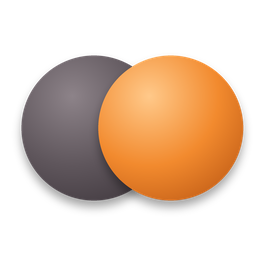
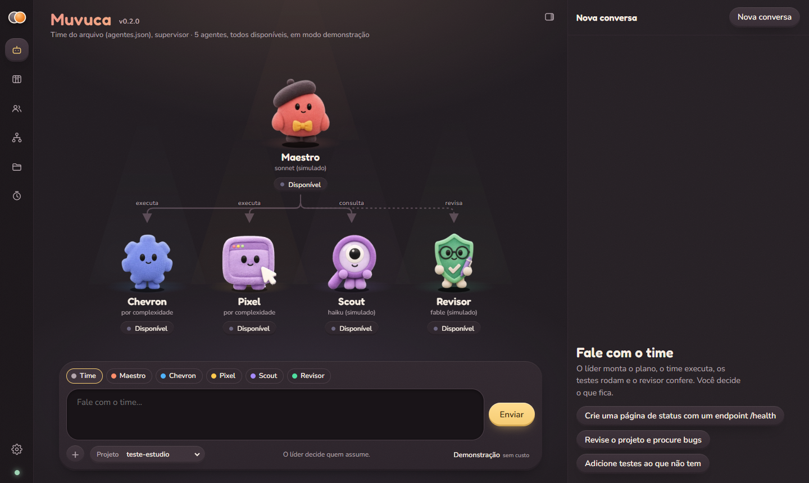
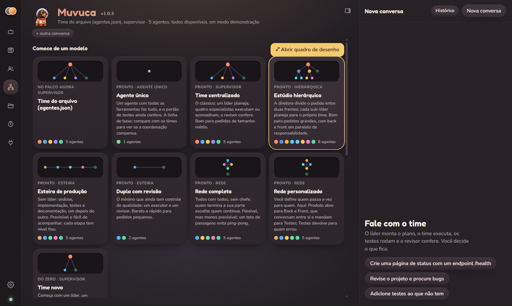
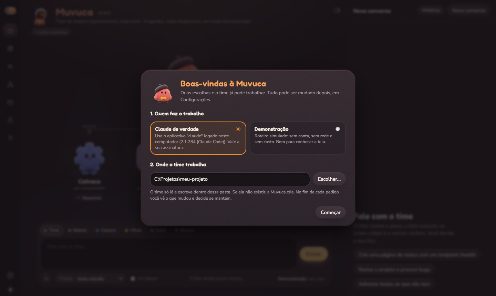
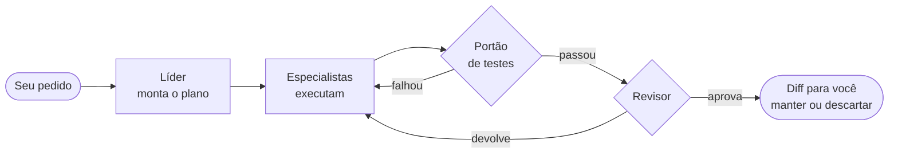

<div align="center">



# Muvuca

**Um time de agentes de IA trabalhando no seu projeto, na sua máquina, com você no comando.**

[](https://github.com/Silly-Machine/muvuca/actions/workflows/testes.yml)
[](https://github.com/Silly-Machine/muvuca/actions/workflows/instaladores.yml)


[](LICENSE)



</div>

## O que é

A Muvuca é um painel local para trabalhar com um time de agentes de IA. Você escreve um pedido; um líder monta o plano, especialistas executam, os testes rodam e um revisor confere. No fim você vê o que mudou, arquivo por arquivo e com o autor de cada um, e decide se mantém ou descarta tudo.

Ela roda no seu computador e usa o **seu** Claude: o aplicativo `claude` (Claude Code) já logado na sua assinatura. Nenhuma chave de API é necessária, e nada do seu projeto passa por um servidor da Muvuca, porque não existe um.

> **Estado do projeto:** protótipo em evolução (versão 0.2.0). Funciona de ponta a ponta e tem testes, mas leia [o que foi testado e o que não foi](docs/guia.md#o-que-foi-testado-e-o-que-não-foi) antes de apontá-la para um projeto importante.

## Destaques

- **Você decide o que fica.** O time escreve só dentro da pasta do projeto. Cada pedido termina num diff, com "Manter" ou "Descartar"; descartar devolve a pasta ao que era.
- **Portão de testes e revisor.** Os testes são rodados pela Muvuca, não pelo agente que escreveu o código. O que não passa volta para quem fez, até um limite de devoluções.
- **Cinco arquiteturas de time**, com sete modelos prontos: agente único, supervisor, hierárquica, esteira e rede.
- **Construtor visual.** Monte o time arrastando agentes, desenhe as setas de quem responde a quem, apague com a borracha, desfaça com Ctrl+Z.
- **Modelo certo para cada tarefa.** Tarefa simples vai para o modelo leve, revisão vai para o mais forte. Cada agente pode ter o seu.
- **Rotinas, quadro de tarefas e memória.** Pedidos agendados, um quadro com o andamento de cada tarefa e notas que cada agente guarda por projeto.
- **Anexos.** Arraste arquivos ou pastas para a caixa do pedido.
- **Modo demonstração.** Um roteiro simulado, sem conta e sem custo, para conhecer a tela.

<div align="center">


</div>

## Instalação

Para usar o Claude de verdade, instale antes o [Claude Code](https://claude.com/claude-code) e faça login (`claude` num terminal). Sem ele, a Muvuca funciona em modo demonstração.

### 1. Aplicativo de mesa (Windows, macOS e Linux)

Baixe o instalador do seu sistema na página de [Releases](https://github.com/Silly-Machine/muvuca/releases):

| Sistema | Arquivo |
|---|---|
| Windows | `Muvuca.Setup.x.y.z.exe` |
| macOS | `Muvuca-x.y.z-arm64.dmg` (Apple Silicon) ou `Muvuca-x.y.z.dmg` (Intel) |
| Linux | `Muvuca-x.y.z.AppImage` |

Os instaladores ainda não são assinados. Na primeira abertura, o Windows mostra o aviso do SmartScreen ("Mais informações" e depois "Executar assim mesmo") e o macOS pede para abrir com o botão direito e "Abrir".

### 2. Pelo terminal, sem instalar

Precisa de Node 20 ou mais novo.

```sh
npx github:Silly-Machine/muvuca
```

O comando sobe o servidor local e abre a tela no navegador. Opções: `--porta 4318`, `--dados PASTA`, `--sem-abrir`, `--ajuda`.

### 3. Do código-fonte

```sh
git clone https://github.com/Silly-Machine/muvuca.git
cd muvuca
npm start            # servidor + navegador; não precisa de "npm install"
```

Para o aplicativo de mesa em modo de desenvolvimento: `npm install` e depois `npm run app`.

## Primeiros passos

1. **Boas-vindas.** Na primeira abertura, escolha quem faz o trabalho (Claude de verdade ou demonstração) e a pasta do projeto.
2. **Peça.** Escreva o pedido na caixa de texto, por exemplo: "Crie uma página de status com um endpoint /health".
3. **Acompanhe.** O palco mostra quem está pensando, trabalhando ou esperando; o quadro mostra cada tarefa.
4. **Decida.** Leia o diff e escolha "Manter mudanças" ou "Descartar".

Comece por uma pasta vazia ou por um projeto com cópia de segurança (um repositório git, por exemplo).

## Como funciona



O desenho acima é o do supervisor. As outras arquiteturas mudam quem planeja e quem passa o trabalho para quem:

| Arquitetura | Como o trabalho anda |
|---|---|
| Agente único | um agente faz tudo; o portão de testes ainda confere |
| Supervisor | um líder planeja e distribui; todos respondem a ele |
| Hierárquica | o líder divide entre sub-líderes, e cada um planeja para o próprio time |
| Esteira | sem líder: cada etapa passa o trabalho para a seguinte |
| Rede | sem chefe: quem termina a sua parte escolhe quem continua |

O [guia](docs/guia.md) explica cada parte em detalhe: provedores, construtor, rotinas, memória, proteções e limites.

## Estrutura do repositório

```sh
muvuca
    ├── servidor.js          : servidor HTTP local e API da tela
    ├── orquestrador.js      : o protocolo do time (plano, execução, portão, revisão)
    ├── ferramentas.js       : arquivos, comandos, foto do projeto e restauração
    ├── provedores.js        : Claude Code, APIs compatíveis com OpenAI e demonstração
    ├── times.js             : regras de cada arquitetura
    ├── public/              : a tela (um HTML só, sem framework) e os personagens
    ├── arquiteturas/        : os sete modelos prontos de time
    ├── bin/muvuca.js        : o comando "muvuca"
    ├── electron/            : o aplicativo de mesa
    ├── test/                : testes automáticos
    ├── apoio/               : CLIs falsos e roteiros de teste ao vivo
    ├── sprites/             : fontes dos personagens
    └── docs/                : guia completo e imagens
```

Seus dados (preferências, projetos, rotinas, memória, times salvos) ficam em `~/.muvuca`, fora do repositório e fora da pasta do aplicativo.

## Testes

```sh
npm test                    # 43 testes automáticos, cerca de 1 minuto
node apoio/bateria.mjs      # 177 verificações ao vivo, com o servidor em demonstração
```

Os testes automáticos rodam no GitHub Actions em Windows, macOS e Linux a cada envio. Detalhes em [Bateria de testes](docs/guia.md#bateria-de-testes).

## Segurança

- O servidor atende só em `127.0.0.1`; outra máquina da rede não alcança.
- Os agentes leem e escrevem só dentro da pasta do projeto. Arquivos `.env` ficam protegidos.
- Com o Claude Code, quem escreve só consegue rodar `node --test` e `npm test`; qualquer outro comando é negado.
- Nenhuma chave de API fica em arquivo: provedores por API leem a chave de uma variável de ambiente.

## Roteiro

- [x] Dados do usuário fora da pasta do aplicativo e primeira abertura guiada
- [x] Comando `muvuca` e aplicativo de mesa para Windows, macOS e Linux
- [ ] Instaladores assinados e atualização automática
- [ ] Publicação no npm
- [ ] Celular como controle remoto da Muvuca do computador (PWA com pareamento)

## Contribuir

Ideias, relatos de erro e correções são bem-vindos. Veja [CONTRIBUTING.md](CONTRIBUTING.md) para rodar o projeto e os testes, e o [histórico de mudanças](CHANGELOG.md) para o que já entrou.

## Licença

[MIT](LICENSE) © Silly Machine.

A Muvuca é um projeto independente e não é afiliada à Anthropic. "Claude" e "Claude Code" são marcas da Anthropic.
